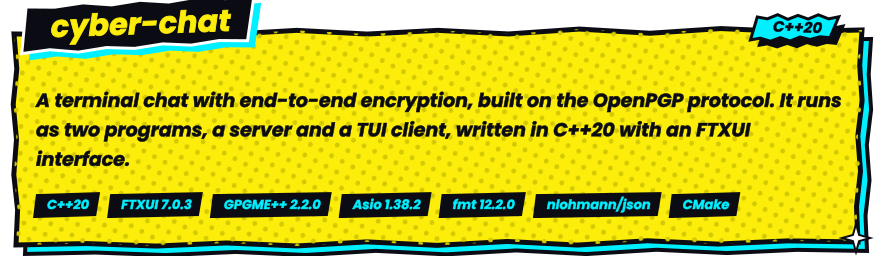
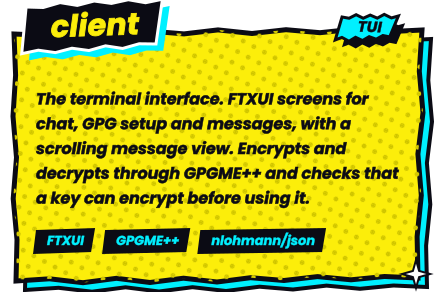
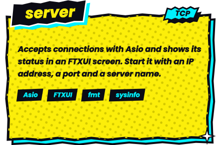
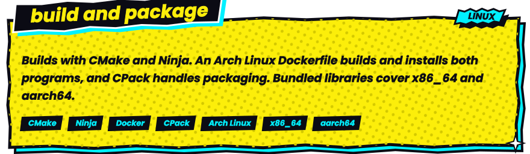
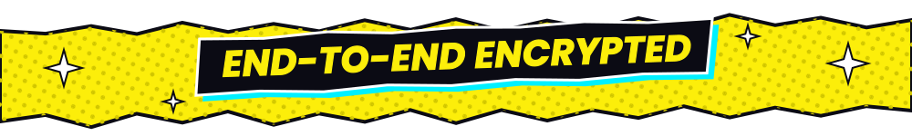

<div align="center">





<table>
<tr>
<td align="center" valign="top"></td>
<td align="center" valign="top"></td>
</tr>
</table>




</div>

```bash
cmake -S . -B build -G Ninja -DCMAKE_BUILD_TYPE=Release
cmake --build build
cmake --install build
```

Start the server with an IP address, a port and a server name:

```bash
server <ip> <port> <server name>
```

<div align="center">



</div>
